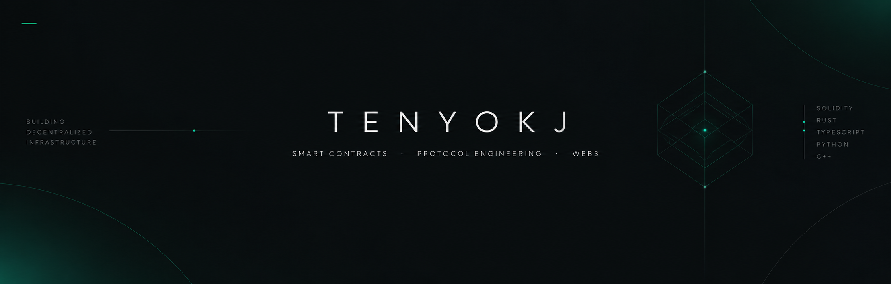

<h1 align="center">Tenyokj</h1>

  <b>Smart Contract Engineer · Protocol Developer · Web3 Builder</b>

  Designing and building blockchain infrastructure, on-chain systems, and decentralized protocols.

  <a href="https://tenyokj.vercel.app">Portfolio</a>
  ·
  <a href="https://github.com/Tenyokj">GitHub</a>
  ·
  <a href="https://t.me/tenkoffj">Telegram</a>

---

<!-- BANNER: Add profile-banner.png to the root of your profile repository -->

  

## About

I'm a software developer focused on **Web3 engineering, smart contracts, and protocol development**.

I build blockchain systems from the ground up — from contract architecture and protocol mechanics to testing infrastructure, integrations, and application layers.

My primary focus is the Ethereum ecosystem and EVM-compatible chains. I enjoy working on complex systems where security, economic incentives, decentralization, and architectural decisions matter.

I also build general-purpose software, developer tools, and backend systems.

**Current interests:**
- Smart contract and protocol engineering
- DAO governance and decentralized coordination
- DeFi mechanisms and on-chain financial systems
- Consensus protocols and distributed systems
- Smart contract security and testing
- Open-source infrastructure

---

## Core Expertise

### Smart Contracts & EVM

  
  
  
  
  

- Solidity contract development and architecture
- EVM execution model, transactions, calldata, storage, and memory
- Contract inheritance, interfaces, abstract contracts, and libraries
- Custom errors, events, modifiers, and access control
- Reentrancy protection and checks-effects-interactions
- Low-level calls, `delegatecall`, and contract interactions
- Native ETH and ERC-20 payment flows
- Tokenomics and on-chain accounting
- Upgradeable contracts and proxy patterns
- Contract modularity and reusable components
- Gas profiling and optimization
- Contract deployment and verification
- EVM-compatible networks and testnets

### Development Frameworks & Tooling

  
  
  
  
  

- Foundry: Forge, Anvil, Cast, and Chisel
- Hardhat development environments and plugins
- OpenZeppelin Contracts and upgradeable libraries
- Ethers.js and contract interaction
- Contract compilation and artifact management
- Local blockchain environments and forking
- Deployment scripts and network configuration
- Environment management and RPC integration
- Contract verification and ABI integration
- Reproducible development workflows

### Token Standards & Contract Interfaces

  
  
  
  
  

- ERC-20 fungible tokens and extensions
- ERC-721 NFTs
- ERC-1155 multi-token contracts
- ERC-165 interface detection
- ERC-2612 permit approvals
- ERC-4626 tokenized vaults
- ERC-2771 meta-transactions
- ERC-2981 NFT royalty interfaces
- ERC-1967 proxy storage conventions
- ERC-1822 UUPS proxy standard
- ERC-2535 Diamond architecture
- ERC-3156 flash loan interfaces
- ERC-4337 account abstraction architecture
- ERC-1271 contract signature validation
- ERC-5267 EIP-712 domain discovery
- EIP-712 typed structured data
- EIP-2612 signature-based approvals

*Standards listed here represent areas of development and technical familiarity, not a claim of equal production experience with every standard.*

### DeFi & Protocol Engineering

- Automated market makers (AMMs)
- Liquidity pools and LP accounting
- Constant-product market-making models
- Token swaps and slippage calculations
- Treasury and escrow systems
- Staking and reward distribution
- Lending and borrowing mechanisms
- On-chain governance and voting
- Proposal lifecycle and execution
- Milestone-based funding mechanisms
- Payment streams and vesting
- Protocol fees and accounting
- Stablecoin-based applications
- Access control and role management
- Economic incentives and protocol design

### Testing & Smart Contract Security

- Unit and integration testing
- Foundry tests and fuzz testing
- Hardhat test suites
- Fixtures and reusable test setups
- Revert conditions and custom-error assertions
- Access-control testing
- Invariant testing concepts
- Stateful fuzzing concepts
- Edge-case and boundary testing
- Reentrancy and authorization checks
- Integer precision and rounding analysis
- Signature validation and replay protection
- Upgradeability and storage-layout considerations
- Gas reports and coverage analysis
- Failure-mode and adversarial testing

*Security practices are part of my development workflow. They do not imply that every project has undergone an independent audit.*

---

## Other Technologies

### Languages

  

- **Solidity** — smart contracts and EVM protocol development
- **TypeScript / JavaScript** — Web3 applications, integrations, and tooling
- **Python** — scripting, automation, and general-purpose development
- **Rust** — systems programming and blockchain-related exploration
- **Vyper** — Python-inspired smart contract development
- **C++** — programming fundamentals and systems-oriented exploration

### Frontend & Web3 Integration

  

- React and Next.js
- TypeScript and JavaScript application architecture
- Ethers.js contract integration
- Wallet connection and transaction flows
- On-chain data presentation
- Responsive application interfaces
- Tailwind CSS
- Vite-based development workflows

### Backend, Data & Infrastructure

  

- Node.js and backend development
- REST APIs and external service integrations
- GraphQL and The Graph ecosystem
- Git and GitHub workflows
- Docker and containerized environments
- Linux and server administration
- Development automation and scripting
- IPFS and decentralized storage concepts
- Local development environments and tooling

---

## Currently Building

### BERT DAO

**Stablecoin-native grant infrastructure**

BERT DAO is my primary project: an on-chain system for coordinating community funding and selecting ideas through stake-backed mechanisms.

The protocol explores how stablecoin commitments, transparent proposal selection, refundable pledges, and milestone-based funding can work together in a decentralized funding system.

**Focus areas:**
- USDC-based funding mechanisms
- Proposal and funding-round lifecycle
- Stake-backed selection and voting
- Refundable pledge accounting
- Treasury and fee management
- Funding eligibility and settlement rules
- Smart contract architecture and testing

**Network:** Arc Testnet

**Status:** Active development. Testnet software; not independently audited.

- [Website](https://bertdao.vercel.app)
- [BERT DAO repository — add the correct URL](https://github.com/Tenyokj/bert-core-arc)

Contributions, technical feedback, and discussions are welcome.

### ICFT Protocol

**Consensus protocol · Distributed systems**

I'm also actively developing ICFT Protocol with a team.

The project focuses on consensus and protocol-level engineering, exploring the mechanisms required for distributed participants to coordinate and reach agreement.

**Current focus:**
- Consensus protocol design
- Distributed coordination
- Protocol architecture
- Implementation and testing
- Reliability and failure scenarios

**Status:** Active development.

- [ICFT Protocol repository — add the correct URL](https://github.com/ICFTProtocol)

More technical details will be added as the project evolves.

---

## Selected Work

Beyond my current projects, I work on blockchain protocols, developer tooling, and general software.

| Project | Description |
|---|---|
| **BERT DAO** | Stablecoin-native grant infrastructure and on-chain funding mechanisms |
| **ICFT Protocol** | Team-based consensus protocol development |

Explore more on [GitHub](https://github.com/Tenyokj).

---

## Open Source & Opportunities

I'm interested in building meaningful software, contributing to open-source infrastructure, and working with teams that value engineering and ownership.

**Currently open to:**
- Paid Smart Contract Engineer / Solidity Developer roles
- Full-time or long-term engineering positions
- Monthly-compensated development engagements
- Paid startup collaborations
- Web3 protocol engineering
- Smart contract and DeFi development
- Open-source contributions and technical collaboration

I can contribute across the development lifecycle: protocol design, contract implementation, testing, integrations, tooling, and application development.

If you're building something technically ambitious, feel free to reach out.

---

## GitHub Activity

  
  

  

---

## Contact

  
  
  
  

---

  Building protocols. Engineering systems. Shipping open source.

